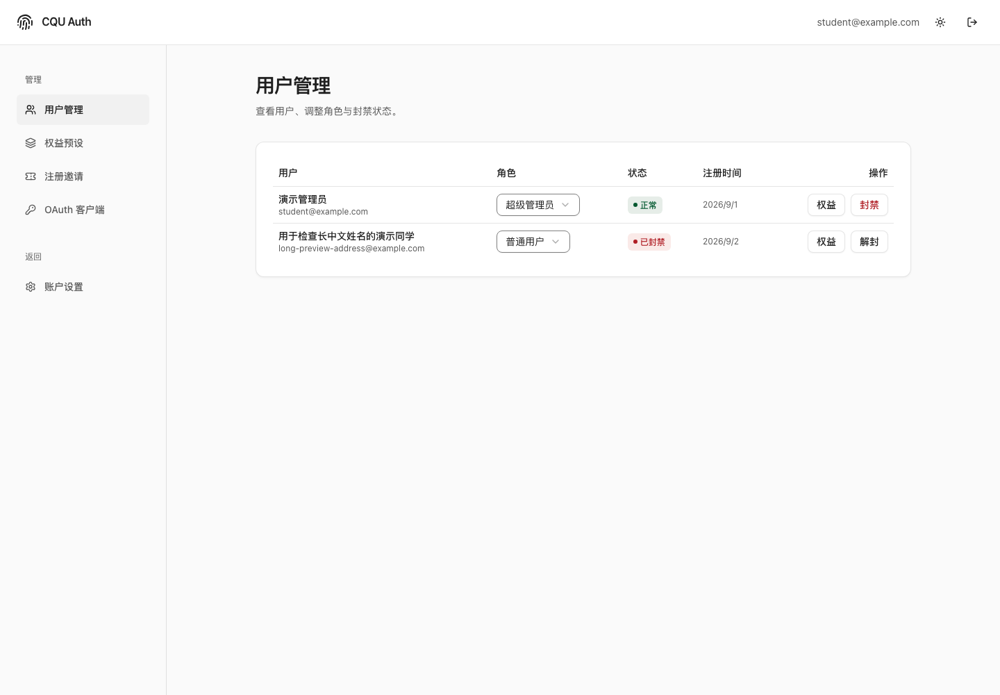
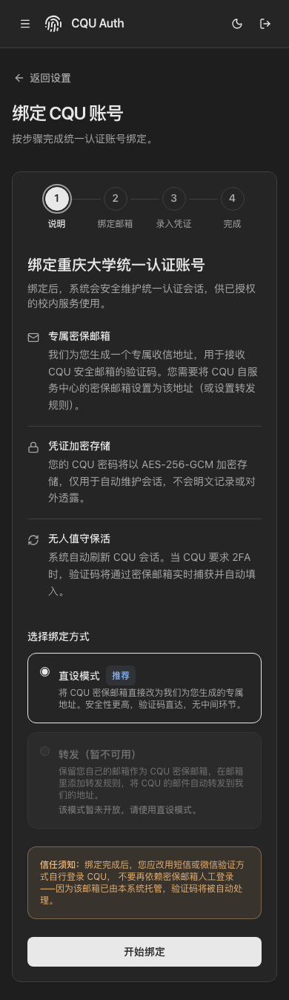
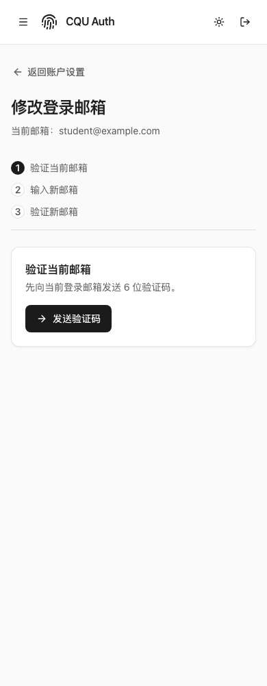

# Auth 前端视觉优化

采用 CQU Moe Design 1.1.0。设计预览已上线：https://cqu-moe-design.user-unauthorized.workers.dev/admin 。

## 改动

统一账号、安全、邮箱修改、CQU 绑定与管理页面的中性表面、页头、分组、留白和轻边界。移除嵌套灰框、重复说明与装饰性闪烁，保留真实状态的语义颜色。绑定步骤在手机上显示完整名称；列表危险操作保持红字提示。

共享控件来自同版 theme/ui 本地 tarball；此变更不修改认证协议、权限或 API。Auth 尚未部署，本文件中的截图全部来自拦截 API 的演示数据。

## 验证

- frontend：pnpm build、pnpm check:design 通过。
- npm test -- frontend/src：31 个文件、167 项测试通过。
- 9 个关键页面 × 320/390/1440 × 双主题，共 54 个浏览器布局检查通过，生成 36 张截图。
- 检查了长中文名称、无页面横向溢出、手机步骤名称、密码编辑器取消和 OAuth 弹窗 Escape 关闭；测试阻止全部 API 写请求。
- 共享 design 已通过 69 项浏览器检查及独立 consumer 验证。
- 构建仍有既有大 chunk 提醒；未进行真实账号业务验收或真实手机测试。

## 代表截图

